# APIOps Governed Pipelines

Azure DevOps pipelines that run Microsoft's [APIOps CLI](https://github.com/Azure/apiops-cli) (`apiops extract` and `apiops publish`) with the guardrails a team needs:
- choose the target from a list
- one variable group per target
- environment approvals for extraction as well as publishing
- Spectral linting
- pull-request-only changes
- configuration placeholders that fail loudly
- dry runs

The CLI itself is used unmodified: the pipelines install a pinned version from npm (`@azure-tools/apiops-cli` 1.0.5 by default). Upgrading means changing one version number.

The CLI replaces the original [APIOps toolkit](https://github.com/Azure/apiops), which Microsoft is archiving. If you used the toolkit's v7 extractor and publisher, see [Moving from the APIOps toolkit](#moving-from-the-apiops-toolkit).

> This is a community project. It is not affiliated with or supported by Microsoft.

## What it adds

| Concern | How it's handled |
|---|---|
| Picking the target | Region and environment dropdowns. Nobody types an instance name. |
| Environment values | One variable group per region and environment. The YAML contains no instance names. |
| Approvals and audit trail | Every run is a deployment job against an Azure DevOps environment, so approvals, checks and deployment history apply to both extracting and publishing. |
| API quality | Spectral lints every extracted OpenAPI definition. Results appear in the run's **Tests** tab. Starts advisory, can be switched to blocking. |
| Change control | The extractor never commits directly. It opens a pull request into `main`. |
| Per-environment values | `{#TOKEN#}` placeholders in publisher configurations are filled from the variable group. A missing value **fails the run** instead of publishing the literal placeholder. |
| Publishing from the wrong place | Outside `Development`, only `main` can publish. Pair this with a Branch control check on the environment. |
| "Green but nothing published" | The run warns when the latest commit changed no artifacts. |
| Trying before applying | Dry run mode lists every resource the CLI *would* create, update or delete, and changes nothing. |
| Identity | One service connection per environment. Workload identity federation works out of the box; no client secrets are needed. |
| Incomplete runs | A partial result from the CLI fails the run, so a half-finished extract never becomes a pull request. |

## How it works

<picture>
  <source media="(prefers-color-scheme: dark)" srcset="docs/assets/architecture-dark.svg">
  
</picture>

`main` holds the desired state of your APIs in `apim-artifacts/`. Changes reach `main` only through pull requests: either from the extractor (changes made in the APIM portal) or edited by hand. The publisher deploys `main` to one target at a time, applying that target's overrides. Promotion means publishing the same commit to the next environment, behind that environment's approvals.

See [docs/architecture.md](docs/architecture.md) for each step, the components and how sign-in works.

## Repository layout

```
.spectral.yaml                      Spectral ruleset for extracted API definitions
apim-artifacts/                     Desired APIM state. Created by the first extractor pull request.
configurations/
├── _examples/                      Annotated extractor and publisher configurations
└── <region>/<environment>/         Optional per-target configuration files
docs/
├── architecture.md                 Workflow, components and authentication
└── assets/                         Architecture diagram (light and dark)
infra/
└── terraform/                      Optional: creates demo APIM instances and identities
pipelines/
├── run-extractor.yaml              Entry point: region + environment
├── run-publisher.yaml              Entry point: region + environment + mode + dry run
└── templates/                      Shared settings and step templates
scripts/                            PowerShell used by the steps (pwsh 7, also runs on 5.1)
```

## Quick start

The Region dropdown offers `WestUS` (default), `EastUS` and `WestEurope`, and there are four environments (`Development`, `Testing`, `UAT`, `Production`). Resource names use the region and environment in lowercase, matching Azure region names (for example `apiops-westus-production` and `apiops-production`). You only need variable groups for the regions you actually use; picking a region without one fails the run before anything happens. Edit the lists in both entry pipelines to fit your setup (see [Adding a region or environment](#adding-a-region-or-environment)).

No API Management instances to try this on? [`infra/terraform`](infra/terraform/README.md) creates them, with one managed identity per environment for the service connections. It also covers steps 2 and 4 below.

### 1. Put the repository in Azure Repos

Import this repository into a project (**Repos → Import repository**), or push a copy. The pull request step uses Azure Repos.

### 2. Create a service connection per environment

**Project settings → Service connections → Azure Resource Manager**, using workload identity federation. Name them `apiops-development`, `apiops-testing`, `apiops-uat` and `apiops-production`.

Give each identity two roles, both limited to its own environment:
- **API Management Service Contributor** on the APIM instance(s).
- **Reader** on their resource group. `apiops publish` reads the resource group in a pre-flight check and stops without it.

The CLI signs in through the service connection's Azure CLI session, so no secret is stored.

### 3. Create the environments and their checks

**Pipelines → Environments**: create `apiops-development`, `apiops-testing`, `apiops-uat` and `apiops-production`. Add checks under **⋮ → Approvals and checks**. A good starting point:

| Environment | Checks |
|---|---|
| `apiops-development` | none |
| `apiops-testing` | Approvals |
| `apiops-uat` | Approvals |
| `apiops-production` | Approvals, Branch control (`refs/heads/main`), Exclusive lock; optionally Business hours |

All regions share one environment per tier, so one policy covers every region.

### 4. Create a variable group per target

**Pipelines → Library**: one group per region and environment, named `apiops-<region>-<environment>` in lowercase (for example `apiops-westus-production`).

| Variable | Required | Value |
|---|---|---|
| `APIM_NAME` | yes | APIM instance name |
| `APIM_RESOURCE_GROUP` | yes | Its resource group |
| `AZURE_SUBSCRIPTION_ID` | no | Its subscription. Defaults to the service connection's subscription. |
| `NV_*` (your choice of names) | as needed | Values for `{#NV_...#}` placeholders in that target's publisher configuration |

Any setting in [`pipelines/templates/variables.yaml`](pipelines/templates/variables.yaml) can also be overridden per target by adding it to the group.

### 5. Let the pipeline open pull requests

**Project settings → Repositories → (this repo) → Security**. For **`<Project> Build Service (<organisation>)`**, allow **Contribute**, **Create branch** and **Contribute to pull requests**.

### 6. Create the two pipelines

**Pipelines → New pipeline → Azure Repos Git → (this repo) → Existing YAML file**:
- `/pipelines/run-extractor.yaml`, named for example "APIOps extractor"
- `/pipelines/run-publisher.yaml`, named for example "APIOps publisher"

On the first run of each target, Azure DevOps asks you to permit the pipeline to use the variable group, the service connection and the environment. Choose **Permit**.

### 7. Extract from Development

Run **APIOps extractor** with *Environment* = `Development`. Review the pull request it opens, check the lint results in the run's **Tests** tab, and merge.

### 8. Publish to the next environment

Run **APIOps publisher** from `main`:
1. Pick `Testing` and tick **Dry run**.
2. Read the log, which lists every resource the CLI would create, update or delete.
3. Run again without dry run.
4. Approve when asked.

### 9. Protect `main`

Add a branch policy on `main` (**Repos → Branches → ⋮ → Branch policies**) that requires a reviewer. Pull requests are then the only way in.

## Everyday flow

1. Someone changes an API in the Development APIM instance, or edits files under `apim-artifacts/` in a pull request.
2. For portal changes, run the extractor against `Development` and merge its pull request.
3. Run the publisher for `Testing`, then `UAT`, then `Production`. Each run waits for that environment's approvals.

Values that differ between environments (backend URLs, client IDs, Key Vault references) go in each target's publisher configuration. See [configurations/README.md](configurations/README.md).

### Publish modes

| Mode | Publishes | Deletes in APIM |
|---|---|---|
| `changes-in-latest-commit` (default) | Artifacts added or changed in the commit the run was queued from (`--commit-id`) | Yes, artifacts deleted in that commit (`--delete-unmatched`, limited to that commit) |
| `all-artifacts` | Every artifact under `apim-artifacts/` | No |

Pull requests from the extractor are squash-merged, so one merge equals one commit, and the default mode publishes exactly that change. If you merged something else afterwards (for example documentation), the run warns that the latest commit changed no artifacts and nothing is published. Use `all-artifacts` in that case, or to bring a new environment up to date. A commit that only changes a publisher configuration also publishes nothing in the default mode.

### One branch for every environment

There is no branch per environment. Every environment is published from `main`, and promotion means publishing the same commit to the next environment, behind that environment's approvals.

- **Why not a branch per environment?** Environments differ only in their values, and those live in `configurations/<region>/<environment>/`, not in the artifacts. With a branch per environment, the same change is merged several times and the branches drift apart. Production can then receive something Testing never saw. With one branch, the commit you tested in Testing is the commit you publish to Production.
- **What's deployed where:** open **Pipelines → Environments → `apiops-<environment>` → Deployments**. It lists every run against that environment, and each run shows the commit it published. Dry runs appear there too; the stage name of each run ("Dry run …" or "Publish …") tells them apart.
- **Publishing an earlier commit:** if `main` has moved on (say a documentation commit after the merge you want to promote), queue the run on that commit instead of the tip. It still runs from `main`, so Branch control passes:

  ```bash
  az pipelines run --name "Run ApiOps Publisher" --branch main --commit-id <merge-commit> \
    --parameters region=WestUS environment=Production mode=changes-in-latest-commit dryRun=true
  ```

- **Hotfixes** are pull requests to `main` like any other change. Publish them through the environments in order, or straight to Production when the fix can't wait. Production's approvals still apply.

## Settings

[`pipelines/templates/variables.yaml`](pipelines/templates/variables.yaml):

| Variable | Default | Meaning |
|---|---|---|
| `APIOPS_CLI_VERSION` | `1.0.5` | APIOps CLI version to install from npm. Always an exact version. |
| `ARTIFACTS_FOLDER` | `apim-artifacts` | Folder that holds the APIM artifacts (the CLI's default name) |
| `RELEASE_BRANCH` | `main` | Pull request target. Outside Development, the only branch allowed to publish. |
| `LINT_MODE` | `advisory` | `advisory` reports issues; `blocking` stops the pull request on error-severity issues |
| `SPECTRAL_CLI_VERSION` | `6.17.0` | Pinned Spectral CLI |
| `NODE_VERSION` | `24.x` | Node.js for the APIOps CLI (22 or later) and Spectral |

Lint rules live in [`.spectral.yaml`](.spectral.yaml). Change rules there deliberately, and raise a rule to `error` once your APIs pass it.

## Adding a region or environment

1. Add the value to the `region` or `environment` list in **both** `pipelines/run-extractor.yaml` and `pipelines/run-publisher.yaml`.
2. Create the matching variable group (`apiops-<region>-<environment>`, in lowercase). For a new environment, also create the Azure DevOps environment and service connection (`apiops-<environment>`, lowercase).
3. Optionally add `configurations/<region>/<environment>/` files (lowercase folder names).

Only `Development` may publish from any branch. To change that rule, edit `enforceReleaseBranch` in `run-publisher.yaml`.

## Design decisions

- **One stage built from parameters, not one stage per target.** Names are computed from the selected values at compile time, so adding a target never means copying a stage. Only the selected target's resources are referenced, so Azure DevOps only asks for permission to those.
- **The service connection is chosen by naming convention, not from a variable group.** Service connections are resolved when the pipeline compiles, before variable groups load.
- **Extraction is a deployment job too.** Reading production configuration is as sensitive as writing it.
- **One branch, `main`, for every environment.** Promotion is the same commit published again behind the next environment's approvals, not a merge between branches. See [One branch for every environment](#one-branch-for-every-environment).
- **Scripts instead of inline code.** Every step calls a file in `scripts/`, so the logic can be read, reviewed and tested outside a pipeline.
- **Placeholders are replaced by a script, not a marketplace task.** There is no extension to install, and a missing value fails the run. Placeholders must be inside double quotes so values can be escaped safely.
- **No secrets in the pipeline.** The CLI runs inside the Azure CLI task, which signs in with the target's service connection. The CLI's `DefaultAzureCredential` picks up that session, so workload identity federation works without client secrets or tokens in variables.
- **A pinned CLI, never `latest`.** Every run of a given commit uses the same CLI version, and upgrades are a reviewed change.
- **Partial results fail the run.** The CLI reports partial success with exit code 1. A partial extract would open a pull request that deletes the resources that failed, and a partial publish leaves the instance out of step with `main`, so both are treated as failures.

## Troubleshooting

| Symptom | Cause and fix |
|---|---|
| `Insufficient permissions to read resource group` | The identity lacks **Reader** on the APIM instance's resource group (step 2). `apiops publish` checks this before planning anything. |
| `APIM_NAME has no value` | The variable group `apiops-<region>-<environment>` doesn't define it, or the pipeline isn't permitted to use the group. |
| "This pipeline needs permission to access a resource" | First run against a target. Choose **Permit**. |
| `Could not create the pull request` | The build service identity lacks **Contribute to pull requests** (step 5). |
| Push rejected / `TF401027` | The build service identity lacks **Contribute** or **Create branch** (step 5). |
| `placeholder ... must be inside double quotes` | Write `value: "{#NV_X#}"`, not `value: {#NV_X#}`. |
| `no value for NV_X` | Add `NV_X` to the target's variable group. If it's a secret variable, map it in the "Resolve publisher configuration" step's `env:` block, or switch to a Key Vault reference. |
| `only allowed from 'main'` | Queue the publisher from `main`, or (for experiments) publish to `Development`. |
| Warning: "latest commit changed nothing under apim-artifacts/" | Re-run with `all-artifacts`, or queue the run right after merging the extractor's pull request. |
| `apiops ... finished with partial failures (exit code 1)` | Some resources failed. The errors are in the log above the message. Fix them and run again. |
| `The APIOps CLI needs Node.js 22 or later` | `NODE_VERSION` was overridden with an older version. |
| `Could not install @azure-tools/apiops-cli@...` | `APIOPS_CLI_VERSION` isn't a published version, or the agent can't reach the npm registry. |
| A secret named value is skipped or blocks the publish | The extractor writes secret values as `*** REDACTED ***`. Give the named value a Key Vault reference (or a `{#TOKEN#}` value) in the target's publisher configuration. |
| Lint step "succeeded with issues" | Advisory lint findings. See the **Tests** tab. |

## Limitations

- The pull request step targets **Azure Repos**. GitHub-hosted repositories would need `gh pr create` instead.
- Workspaces are extracted and published by the CLI as usual. The configuration examples don't cover them; see the [CLI documentation](https://github.com/Azure/apiops-cli/tree/main/docs).
- Secret pipeline variables must be mapped explicitly (see above). Key Vault references are the recommended pattern.

## Upgrading the APIOps CLI

1. Read the [CLI changelog](https://github.com/Azure/apiops-cli/blob/main/CHANGELOG.md) for breaking changes.
2. Change `APIOPS_CLI_VERSION` in `pipelines/templates/variables.yaml`, or in a single variable group to try it on one target first.
3. Run the publisher against `Development` with **Dry run** and compare the log with a previous run.

## Moving from the APIOps toolkit

Microsoft is archiving the original [APIOps toolkit](https://github.com/Azure/apiops) (the v6/v7 `extractor` and `publisher` binaries) in favour of the CLI. Earlier versions of this repository ran those binaries. What changes when you move:

| | Toolkit v7 | APIOps CLI |
|---|---|---|
| Installed as | Release binaries from GitHub | npm package `@azure-tools/apiops-cli` |
| Configured with | Environment variables | Command-line flags |
| Extractor configuration | `configuration.extractor.yaml` | Same file, passed as `--filter`. Same keys; wildcards and `!` exclusions now work too. |
| Publisher configuration | `configuration.publisher.yaml` | Same file, passed as `--overrides`. Same `name` and `properties` entries. `apimServiceName` is ignored. |
| Dry run | Not built in | `--dry-run` |
| Default artifacts folder | `artifacts` | `apim-artifacts` |

The CLI doesn't promise that its files match the toolkit's byte for byte. To move an existing repository:

1. Extract your Development instance with the new pipeline, and review the pull request it opens against your current folder before merging.
2. Publish to each environment with **Dry run** first and read the planned changes.

## Credits and licence

- [APIOps CLI](https://github.com/Azure/apiops-cli) by Microsoft (MIT), installed from npm at run time. This repository's pipelines started from the [APIOps toolkit](https://github.com/Azure/apiops) sample pipelines (MIT). See [THIRD-PARTY-NOTICES.md](THIRD-PARTY-NOTICES.md).
- [Spectral](https://github.com/stoplightio/spectral) by Stoplight (Apache-2.0), installed at run time.

Released under the [MIT licence](LICENSE).
