# Architecture

## Overview

APIOps extracts an API Management instance into files and publishes those files to other instances. This repository runs Microsoft's APIOps CLI (`apiops extract` and `apiops publish`), unmodified, inside Azure DevOps. Azure DevOps adds the controls APIOps leaves out on purpose: target selection, approvals, review, validation and an audit trail.

`main` in Azure Repos holds the desired state of your APIs. Changes reach it only through pull requests, and every run against an instance is a deployment job behind that environment's checks.

<picture>
  <source media="(prefers-color-scheme: dark)" srcset="assets/architecture-dark.svg">
  
</picture>

## Workflow

| Step | Pipeline | Affected resources | What happens |
|---|---|---|---|
| 01 | APIOps · Extract | Development instance, `apim-artifacts/` | After the environment's checks pass, `apiops extract` reads the instance. Spectral lints every OpenAPI definition, and the results appear in the run's **Tests** tab. |
| 02 | APIOps · Extract | A new `apiops/extract-…` branch, a pull request into `main` | The extracted files are committed to a new branch and a pull request is opened. Nothing is committed to `main` directly. |
| 02 | (people) | `main` | A reviewer checks the changes and the lint results, then squash-merges. |
| 03 | APIOps · Publish | `main` | The publisher is queued from `main`. Outside Development, any other branch is refused. |
| 04 | APIOps · Publish | Testing, UAT, Production instances | One environment per run. Each run waits for that environment's approvals, fills `{#TOKEN#}` placeholders from the variable group, then runs `apiops publish` for the merged commit (or, with **Dry run**, lists what it would change). |

## Components

| Component | Name | Role |
|---|---|---|
| Pipelines | `pipelines/run-extractor.yaml`, `pipelines/run-publisher.yaml` | Entry points with Region and Environment dropdowns. Each run is one deployment job against one target. |
| Step templates and scripts | `pipelines/templates/`, `scripts/` | Install the pinned APIOps CLI, run it, lint, open the pull request, resolve placeholders, write the run summary. |
| Variable groups | `apiops-<region>-<environment>` | The target's APIM name, resource group, subscription and placeholder values. The YAML contains no instance names. |
| Environments | `apiops-<environment>` | Approvals, branch control, exclusive lock and deployment history, shared by every region. |
| Service connections | `apiops-<environment>` | Workload identity federation to an Entra ID identity with **API Management Service Contributor** on that environment's instance and **Reader** on its resource group, nothing else. |
| Configuration | `configurations/<region>/<environment>/` | Optional extractor filter and publisher overrides per target. |
| Demo infrastructure | `infra/terraform/` | Optional. Creates the instances, identities and role assignments. |

Region and environment names appear in lowercase in every resource name (for example `apiops-westus-production`).

## Authentication

Each service connection signs in to Azure with workload identity federation, so no client secret is stored. The CLI runs inside the Azure CLI task, which has already signed in with the target's service connection, and the CLI's `DefaultAzureCredential` uses that session. No token passes through pipeline variables. Each identity can change only its own environment's instance, so a Testing run can't change Production. It also has Reader on that instance's resource group, because `apiops publish` reads the resource group in a pre-flight check.

## Relationship to APIOps

The pipelines install the [APIOps CLI](https://github.com/Azure/apiops-cli) from npm at run time (`@azure-tools/apiops-cli`, `APIOPS_CLI_VERSION`, 1.0.5 by default). Nothing in the CLI is changed or redistributed. Upgrading means changing that one version number.

The CLI succeeds the original [APIOps toolkit](https://github.com/Azure/apiops), which Microsoft is archiving. Microsoft's own [Azure DevOps samples](https://github.com/Azure/apiops-cli/tree/main/samples/pipelines/azure-devops) for the CLI push extracted changes to a branch and publish to environments. This repository adds what an enterprise team typically needs on top: a pull request for every extraction, approvals for extracting as well as publishing, a pinned CLI version, placeholders that fail loudly, and partial results treated as failures.

## Updating the diagram

`assets/architecture-light.svg` and `assets/architecture-dark.svg` are the same diagram in light and dark themes. They embed Plus Jakarta Sans and JetBrains Mono (SIL Open Font License 1.1) and Microsoft's API Management and Entra ID icons, used unaltered. Edit both files together.
